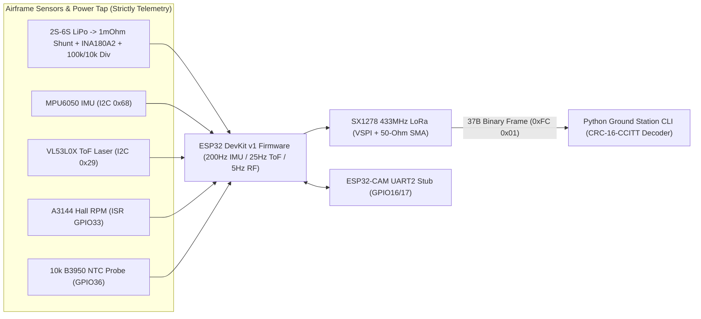

# FlightCore — Modular ESP32 Drone Sensor & 433 MHz LoRa Telemetry System

[](firmware/platformio.ini)
[](tests/)
[](hardware/)
[](LICENSE)

> **STRICT SAFETY CONSTRAINT**: FlightCore is **exclusively a passive sensor acquisition and LoRa telemetry expansion module**. It contains **NO motor/ESC PWM control, NO servo actuation, and NO flight controller stabilization loops**.

---

## System Overview

FlightCore attaches cleanly inline with a `2S–6S` (`7.4 V – 25.2 V`) UAV power bus to acquire inertial attitude, frame vibration, laser altitude, rotor RPM, pack voltage/current/mAh consumption, and thermal probe telemetry, streaming compact **37-byte CRC-16-CCITT binary frames** over **433 MHz LoRa** (`SX1278 Ra-02`) to a companion Python ground station.



---

## Key Engineering Highlights

- **Modular C++17 Firmware (`firmware/`)**:
  - **MPU6050 Driver** ([mpu6050_driver.cpp](firmware/src/mpu6050_driver.cpp)): `400 kHz` I2C, `250`-sample startup bias calibration, complementary roll/pitch filter (`α = 0.98`), and `32`-sample DC-mean-subtracted frame vibration RMS (`mg`).
  - **VL53L0X ToF Driver** ([vl53l0x_driver.cpp](firmware/src/vl53l0x_driver.cpp)): Non-blocking register-level driver with `XSHUT` hardware reset, `5`-tap median + EMA glitch rejection, and timeout diagnostics.
  - **SX1278 433 MHz LoRa Driver & Protocol** ([lora_sx1278.cpp](firmware/src/lora_sx1278.cpp), [telemetry_protocol.cpp](firmware/src/telemetry_protocol.cpp)): `0xFC 0x01` framed 37-byte binary protocol with sequence counter, `CRC-16-CCITT (0x1021/0xFFFF)`, configurable interval (`100–10000 ms`), non-blocking TX retry state machine, and RSSI/SNR link tracking.
  - **Hall-Effect RPM Driver** ([hall_rpm_driver.cpp](firmware/src/hall_rpm_driver.cpp)): `IRAM_ATTR` critical-section ISR on `GPIO33` with `350 µs` glitch debounce, configurable PPR, and timeout zeroing.
  - **Power & Thermal Monitor** ([power_temp_monitor.cpp](firmware/src/power_temp_monitor.cpp)): `16×` oversampled calibrated `ADC1` reads (`VBAT`, `INA180A2` `50 mV/A` current + trapezoidal `mAh` integrator, 3-term Steinhart-Hart NTC temperature).
  - **Diagnostics CLI & ESP32-CAM Bridge** ([main.cpp](firmware/src/main.cpp)): Non-blocking USB Serial CLI (`status`, `json`, `bin`, `hex`, `interval <ms>`, `cal imu`, `reset mah`, `ppr <n>`, `cam ping`) + `UART2` heartbeat bridge stub.
- **Ground Station Decoder (`ground_station/`)**:
  - Byte-exact Python implementation ([protocol.py](ground_station/protocol.py), [receiver_cli.py](ground_station/receiver_cli.py)) supporting live serial (`--serial`), hex dump (`--hex`), binary log playback (`--file`), and synthetic noisy stream simulation (`--simulate --inject-noise`).
- **Manufacturing-Ready KiCad 8 Hardware (`hardware/`)**:
  - Complete schematic, 2-layer `96.0 × 68.0 mm` PCB, netlist, RS-274X Gerbers + Excellon drill (`hardware/gerbers/`), geometric DRC report (`0 errors`), verified BOM ([BOM.csv](hardware/BOM.csv)), [PIN-MAPPING.md](hardware/PIN-MAPPING.md), [POWER-ARCHITECTURE.md](hardware/POWER-ARCHITECTURE.md), and [ASSEMBLY-GUIDE.md](hardware/ASSEMBLY-GUIDE.md).
- **BenchTwin & 3D CAD Staging (`benchtwin/`)**:
  - Structured circuit graph (`flightcore-benchtwin.json`, `flightcore.btw`), vector schematic (`schematic_preview.svg`), simulation notes ([BENCHTWIN-SIMULATION-NOTES.md](benchtwin/BENCHTWIN-SIMULATION-NOTES.md)), and watertight closed-manifold 3D-printable mount (`enclosure_mount.stl`).

---

## Repository Structure

```
04-FLIGHTCORE/
├── firmware/           # PlatformIO ESP32 C++17 modular drivers, main loop & native C++ tests
├── ground_station/     # Python binary CRC-16-CCITT telemetry decoder & CLI
├── hardware/           # KiCad 8 project, Gerbers, DRC report, BOM & hardware guides
├── benchtwin/          # BenchTwin circuit graph/bundle, STL enclosure mount & SVG preview
├── tests/              # Automated pytest verification (protocol, math, C++ native, KiCad/Gerber/STL)
├── docs/               # Detailed system architecture & protocol specs
├── ROADMAP.md          # Engineering phases & passive telemetry roadmap
└── LICENSE             # MIT License
```

---

## Quickstart & Verification

### 1. Build ESP32 Firmware & Static Check (PlatformIO)
```powershell
cd firmware
pio run -e esp32dev
pio check --skip-packages
```

### 2. Run Full Automated Verification Suite (Pytest + Compiled C++17 Native Tests)
```powershell
pytest -v
```
Verifies CRC-16-CCITT, binary encode/decode roundtrips, stream resynchronization, Steinhart-Hart NTC math, complementary filter convergence, vibration RMS, ToF median+EMA glitch rejection, Hall RPM debouncing, strict telemetry-only safety boundary, compiled C++ native tests (`firmware/test/test_flightcore_native.cpp`), KiCad S-expression validity, RS-274X Gerbers, DRC report, BOM/netlist parity, and STL closed-manifold geometry.

### 3. Run Ground Station Decoder CLI Without Hardware
```powershell
python -m ground_station.receiver_cli --simulate --count 6 --inject-noise --format table
```

---

## Hardware BOM Summary

| Subsystem | Key Part | Interface / Rating | Designator |
|---|---|---|---|
| MCU | DOIT ESP32 DevKit v1 (30-pin) | `3.3 V` IO / `5 V` VIN | `U1` |
| 6-Axis IMU | MPU6050 (GY-521) | `I2C 0x68` @ `400 kHz` | `U2` |
| ToF Ranging | VL53L0X (GY-VL53L0XV2) | `I2C 0x29`, `XSHUT=GPIO26` | `U3` |
| 433 MHz LoRa | AI-Thinker Ra-02 (SX1278) | `VSPI`, `+17 dBm`, Edge SMA `J5` | `U4` |
| Current Sense | `1 mΩ 3W 2512` Shunt + `INA180A2` | `50 mV/A`, `V_CM <= 26 V` | `R11`, `U5` |
| Power Rails | `MP1584 5V/3A Buck` + `AMS1117-3.3` | `2S–6S LiPo` + PTC/Schottky/TVS | `U7`, `U6`, `F1`, `D1`, `D3` |
| RPM & Thermal | `A3144EUA-T` Hall + `10 kΩ B3950 NTC` | `GPIO33` ISR / `GPIO36` ADC1 | `U8`, `RT1` |

See [hardware/BOM.csv](hardware/BOM.csv) and [hardware/ASSEMBLY-GUIDE.md](hardware/ASSEMBLY-GUIDE.md) for complete assembly instructions and the mandatory **`JP1` power jumper rule**.
