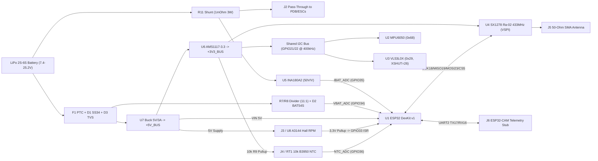
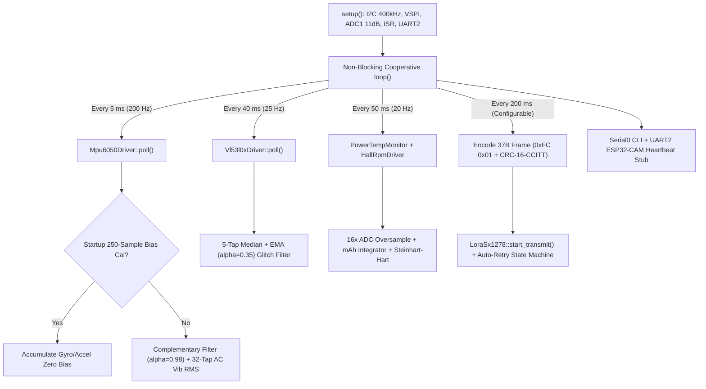

# FlightCore System Architecture

> **Engineering Scope & Safety Boundary**: FlightCore (`flightcore-telemetry`) is strictly an isolated **sensor acquisition and 433 MHz LoRa telemetry expansion subsystem**. It provides zero ESC/motor PWM actuation and does not replace or override the aircraft flight controller.

---

## 1. Hardware & Bus Topology

---

## 2. Firmware Cooperative Scheduler & Data Pipeline

---

## 3. Subsystem Signal Processing Details

### 3.1 MPU6050 Attitude & Frame Vibration (`mpu6050_driver.cpp`)
- **Configuration**: `±4g` accelerometer (`8192 LSB/g`), `±500 deg/s` gyroscope (`65.5 LSB/(deg/s)`), `44 Hz` DLPF (`REG_CONFIG = 0x03`), `200 Hz` sample rate.
- **Startup Bias Calibration**: Collects `250` samples (`~1.25 s` at `200 Hz`), averaging stationary gyro bias (`gx/gy/gz`) and level gravity alignment (`+1g` on `+Z`). Can be re-triggered anytime via `SW1` (`GPIO4`) or CLI `cal imu`.
- **Complementary Fusion**:
  $$\theta_k = 0.98(\theta_{k-1} + \omega_k \Delta t) + 0.02\,\theta_{\text{accel}, k}$$
- **Vibration RMS (`vib_rms_mg`)**: Maintains a `32`-sample rolling window (`160 ms` @ `200 Hz`), subtracts the window DC mean $(\bar{a}_x, \bar{a}_y, \bar{a}_z)$ so static tilt gravity cancels out, and computes 3-axis AC RMS in milligravities (`mg`).

### 3.2 VL53L0X ToF Distance & Glitch Rejection (`vl53l0x_driver.cpp`)
- **Non-blocking Ranging**: Uses `SYSRANGE_START` + interrupt status polling with a `35 ms` timeout guard so slow laser returns never stall the `200 Hz` IMU task. Hardware `XSHUT` (`GPIO26`) enables full I2C reset recovery.
- **Glitch Filter**: `5`-tap median window rejects isolated specular reflections (`> 350 mm` step outliers), followed by EMA smoothing (`alpha = 0.35`). Three consecutive invalid/out-of-range (`< 30 mm` or `> 2000 mm`) reads transition `tof_mm` to `0xFFFF` and clear `STATUS_TOF_RANGE_VALID`.

### 3.3 Hall-Effect RPM (`hall_rpm_driver.cpp`)
- **ISR Ring Buffer**: `IRAM_ATTR` falling-edge interrupt on `GPIO33` captures `64-bit` microsecond timestamps (`esp_timer_get_time()`), guarded by `portMUX_TYPE` spinlock and `350 µs` hardware/software debounce window.
- **Period-to-RPM Math**:
  $$\text{RPM} = \frac{60{,}000{,}000}{\Delta t_{\mu\text{s}} \cdot N_{\text{PPR}}}$$
  Smoothed with EMA (`alpha = 0.40`) and decayed cleanly to `0 RPM` after `1000 ms` without pulses.

### 3.4 Power Integrator & Steinhart-Hart NTC (`power_temp_monitor.cpp`)
- **ADC Conditioning**: `16×` oversampled `analogReadMilliVolts()` leveraging ESP32 factory eFuse ADC calibration curves (`ADC_11db`).
- **Trapezoidal Coulomb Counting**:
  $$Q_{\text{mAh}} \mathrel{+}= \frac{I_{k-1} + I_k}{2} \cdot \frac{\Delta t_{\text{s}}}{3600} \cdot 1000$$
- **3-Term Steinhart-Hart Thermistor Solver**:
  $$R_{\text{NTC}} = 10{,}000 \cdot \frac{V_{\text{ADC}}}{3300 - V_{\text{ADC}}}, \quad \frac{1}{T_{\text{K}}} = A + B\ln(R) + C(\ln R)^3$$
  with `A = 1.127125950e-3`, `B = 2.344443098e-4`, `C = 8.649322763e-8` (exact `25.00 °C` at `10 kΩ`, `60.00 °C` at `2.488 kΩ`, open/short fault flags outside `[10 mV, 3290 mV]`).

---

## 4. Binary Telemetry Frame (`37 Bytes`, Little-Endian)

| Offset | Size | Field | Type / Encoding | Notes |
|---|---|---|---|---|
| `0..1` | 2 | `sync` | `uint8[2]` | Fixed `0xFC 0x01` |
| `2` | 1 | `version` | `uint8` | `0x01` |
| `3` | 1 | `msg_type` | `uint8` | `0x01` Telemetry, `0x02` Diag, `0x03` ACK |
| `4` | 1 | `payload_len` | `uint8` | Fixed `30` |
| `5..6` | 2 | `seq` | `uint16` | Rolling sequence counter |
| `7..10` | 4 | `timestamp_ms` | `uint32` | Node uptime (ms) |
| `11..12` | 2 | `roll_cdeg` | `int16` | `roll_deg * 100` |
| `13..14` | 2 | `pitch_cdeg` | `int16` | `pitch_deg * 100` |
| `15..16` | 2 | `vib_rms_mg` | `uint16` | Frame AC vibration RMS (mg) |
| `17..18` | 2 | `tof_mm` | `uint16` | Filtered ToF distance (`0xFFFF` = invalid) |
| `19..20` | 2 | `rpm` | `uint16` | Rotor RPM |
| `21..22` | 2 | `vbat_mv` | `uint16` | Battery voltage (mV) |
| `23..24` | 2 | `ibat_ca` | `int16` | `ibat_a * 100` (0.01 A) |
| `25..26` | 2 | `consumed_mah` | `uint16` | Integrated mAh |
| `27..28` | 2 | `ntc_temp_cdegc` | `int16` | `temp_c * 100` (`-32768` = fault) |
| `29..30` | 2 | `imu_temp_cdegc` | `int16` | MPU6050 die temp (`0.01 °C`) |
| `31` | 1 | `lora_rssi_dbm` | `int8` | Last link RSSI (dBm) |
| `32` | 1 | `sensor_status` | `uint8` | Subsystem health bitmask (`bit0..bit7`) |
| `33` | 1 | `tx_retries` | `uint8` | Last LoRa packet retry count |
| `34` | 1 | `cam_status` | `uint8` | ESP32-CAM UART2 bridge code (`0..2`) |
| `35..36` | 2 | `crc16` | `uint16` | CRC-16-CCITT (`poly=0x1021`, `init=0xFFFF`) over bytes `[0..34]` |

### LoRa Link Budget (433 MHz, SF7, BW 125 kHz, CR 4/5)
- **Raw Packet Airtime (`37 bytes`, 8-symbol preamble, explicit header, CRC on)**: `~71.9 ms`.
- **Default Rate (`5 Hz` / `200 ms`)**: `~36%` airtime utilization for dedicated bench/range tests; configurable via CLI `interval <ms>` up to `10000 ms` (`0.7%` duty cycle for ISM regulatory compliance).
- **Receiver Sensitivity (SX1278 @ SF7/125kHz)**: `~ -123 dBm`; with `+17 dBm` TX and `~2 dBi` dipoles, free-space link budget exceeds `135 dB`.
